0.写在前面

0.1前言
本项目许可协议
本项目所有代码采用 CC BY-NC-SA 4.0 许可。
● 署名：任何使用、修改或再发布时，必须在显著位置注明本仓库地址
● 非商业性使用：不得将本项目或其衍生作品用于商业目的。如有侵权，将追究到底。
● 相同方式共享：如果你基于本项目进行修改或再发布，必须继续使用 CC BY-NC-SA 4.0 协议，并公开源代码。
● 如果不了解这个开源规则约束下什么事情不能做，可以去问ai。

声明：此项目目前未向任何人授权商业使用，本人闲鱼只有（YumFish）这一个账号，该项目成品仅在快团团（香辣芭乐）和闲鱼（YumFish）进行过合法售卖，
其他渠道得到的商业成品均为侵权！！！

关于这两个玩具，以及对比，看图。
注意：本教程涉及焊接、嵌入式编程、pcb等技术栈，建议动手能力不好的谨慎模仿。
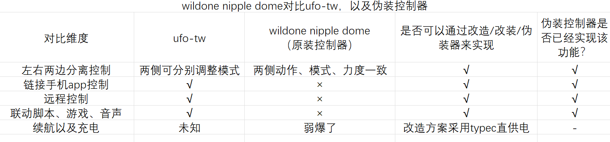

改造思路就是，wildone原装控制器是3.5mm接口（就是耳机、音频接口）的基础上进行的魔改，
既然接口是标准的，那么可以逆向得到控制逻辑，并参考一些网上公开的，ufo-tw的协议
使用单片机（本教程采用esp-32）进行桥接。

由于不想占用过多个人精力，故暂时不再接定制，本文档写的很详细，即使是电路小白，只要有动手能力，就能完整做出来能用的设备。
如果遇到问题，请进入QQ群友好交流。
QQ群：748068145
我的QQ：177078471

0.2 相关链接：
github：https://github.com/Mistpeach/fakeUFO
此项目配套软件：https://github.com/Mistpeach/Web-UFO-Player
配套软件在线使用：https://ufo.yumfish.cn/

1.所需工具

1.1 电烙铁
电烙铁是必须有的。
本项目的焊接部分很少，而且全部都是插件，可以不用焊接任何贴片元件。
市面上基本上你能买到的，合格的电烙铁都足以完成这个项目（甚至拼西西几块钱的也能够用了）。
一般来说，更好的电烙铁用起来会更顺手。
电烙铁内热式好于外热，可调温优于不可调。
至于烙铁头，这个见仁见智，新手可能尖头会好上手一些，我自己用的是小刀头。新手选择烙铁头不建议选择普通刀头，一是加温回温很慢，二是不方便在狭小的地方灵活穿梭。

1.2 焊锡丝
现在市面上的焊锡丝基本上都是松香芯的，随便买一个就好。10克以内焊锡丝即可充足地完成本项目一个电路板的焊接。

1.3 电脑
本教程以Windows电脑演示，如果你是linux或者macos，请向ai寻求帮助。

1.4 可选的工具

1.4.1 助焊剂
助焊剂可以让你在焊接过程中更丝滑。

1.4.2 夹具
夹具的作用是固定电路板不让它移动，可以用身边的其他物品代替。

1.4.3 高温海绵
高温海绵的作用是清理烙铁头，使用前请务必将高温海绵打湿。
烙铁头上面粘的焊锡，加热的时间长会发生氧化，同时焊锡丝里面含的助焊剂会挥发，导致焊锡到不了焊盘上，此时需要把烙铁头上面的焊锡在海面上蹭掉。可以使用湿水卫生纸或棉柔巾、湿巾代替。
注：焊盘，即pcb电路板上面用于与元器件接触的金属部件，根据不同的工艺，会显示不同颜色。OSP-铜色；喷锡-银色；沉金-金色；

1.4.4 口罩
建议在焊接时候戴口罩，并保持通风。口罩防护等级越高越好。焊接时候产生的浓烟，吸入体内对人体有害。
肺活量高的童鞋可以选择憋气大法。

1.4.5 水口钳、斜口钳
这个东西主要是用在焊接完成后剪掉多余的长引脚，防止扎人的。如果你使用传统排针方案，建议使用老虎钳或普通尖嘴钳子来剪断引脚。
水口钳可以使用指甲刀代替。

1.5 如何白嫖工具？
这时候就要请出电子界的大善人嘉立创了，嘉立创旗下的立创商城是一个售卖电子元器件、工具等的平台。
平台新用户注册可以送各种优惠券，还有首单一分购活动。建议使用微信扫码注册
链接：
https://activity.szlcsc.com/newuser.html?from=dfb&spm=sc.hm.fad&lcsc_vid=FVRbAVBVFlVfUlYFRAJWVwVVE1UMUFZVFABcXgZVQAUxVlNfRVFZVlJeQlVaVDtW
（之前还有邀请新用户的活动，现在也没有了。。。）
立创商城学生认证也可以领一些优惠券
链接：
https://activity.szlcsc.com/landing/B7DE73440EA467E8786955EFEE82F3D9.html?from=wdgn&spm=sc.hm.fn.0___sc.hm.mb.lg&lcsc_vid=FVRbAVBVFlVfUlYFRAJWVwVVE1UMUFZVFABcXgZVQAUxVlNfRVFZVlJeQlVaVDtW
立创商城小程序端，每月可参加一次团购秒杀，使用对应手机号的微信搜索立创商城小程序，首页-天天团。

2.所需材料

2.1 必须购买的元器件材料

esp32-c3-supermini开发板 x1 淘宝搜，10元左右。注意尺寸，不要买错了装不上。注意不要买成拓展板。小白建议购买焊接好排针的。
参考链接：https://e.tb.cn/h.RwUDRcgTVfwgo8J?tk=mw9hglkJzC9

3.5mm耳机插座母座 x2 封装是pj-313，要买三节的，就是5pin或者6pin，淘宝搜关键词：3.5mm母座pj-313
注意必须要买插件，否则焊接会有难度。
参考链接：https://e.tb.cn/h.j0BnOc8Y4L83wSe?tk=aHMhTHyT9yd

tb6612fng电机驱动模块 x1 淘宝直接搜就行。注意尺寸，买错了装不上。小白建议购买焊接好排针的。
参考链接：https://e.tb.cn/h.j1hhmCOEUMpjxfa?tk=NYSRTHy6NQm

2.2 排母

强烈建议小白选择排母方案
传统方案是，模块通过排针直接焊接到pcb，是直接焊死。
电子模块的良率不是很高，新手建议用排母方案，避免模块出现问题，到时候不好拆下来。
排母规格:2.54间距   引脚加长 1x8p   
一个控制器需要4条，建议多买几条备用
一定要买引脚加长的排母，否则难以焊接。
参考链接：https://e.tb.cn/h.j1fnx8sel7Djrrs?tk=ponUTHvQuVK
排母方案的好处:电路板上焊接排母，主控模块是可插拔的，如果模块有质量问题，可方便拔下来更换，不用费劲拆焊了。(拆焊十分甚至有九分麻烦)
坏处:无法使用3d打印的外壳，因为排母也占一部分高度。
注意：如果使用排母方案，还需要使用胶带或者热缩管进行绝缘。想必你们也不想涩涩的时候冒火花吧，
就把做好的板子整体包起来就好，不要让金属引脚漏在外面。

2.3 可选材料
保护电机的电容，貌似可以通过吸收pwm尖峰的形式来保护电机，具体电容型号未知，因为我没有用这个东西。总之板子上留的有焊盘，不要也行。

2.4 需要下单定制的材料

2.4.1 PCB电路板
pcb是必须要准备的，它的作用是为元器件提供一个平台，并用内部的铜线正确的链接各个元器件以及接口。
这个东西可以白嫖。
全体起立！这时候就又又又要请出电子界的大善人嘉立创了，嘉立创为我们每月提供了两次的免费pcb的机会。

2.4.1.1 登录或注册
电脑浏览器进入这个链接：
https://www.jlc.com/
右上角，使用和立创商城相同的登陆方式登录嘉立创官网。

2.4.1.2 参加考试
嘉立创目前只有通过考试的用户可以领取沉金工艺免费券，否则只能领取osp工艺免费券。考试很宽松，人人都能过。
相对比，沉金工艺的pcb性能更好，焊接更容易，也更能抗氧化。

进入  嘉立创客户中心，  链接
https://member.jlc.com/

点击左侧用户中心-更多服务-嘉立创题库
然后在打开的页面点击开始考试

进入考试后，可以使用ai工具拍照搜索答案，按我的经验，多选题基本上是全选的，其他题目随便选也能通过考试。

2.4.1.3 领取优惠券
点击左侧用户中心-优惠券中心-PCB免费券
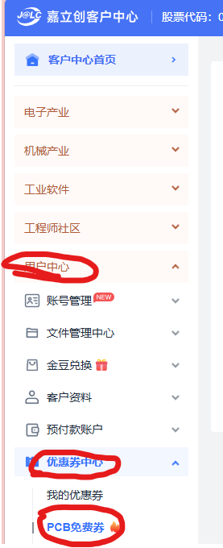
下拉选择对应的优惠券进行领取，通过考试选择2-4层沉金EDA专用券，未通过就选择1-6层板OSP EDA专用券
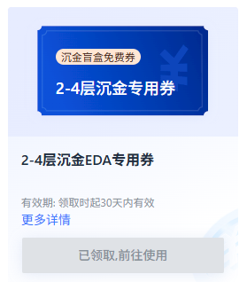

2.4.1.4 打开pcb工程并进行下单
电脑浏览器打开这个链接：
https://u.lceda.cn/join?type=project&key=e0db5475a3616641f8d88ceb35fd80e0&inviter=2ea6d92dd56247efaa15050ddcc8d6e7
使用前面一样的账号登录嘉立创eda，加入工程，再点击查看详情
在新页面点击-编辑器打开
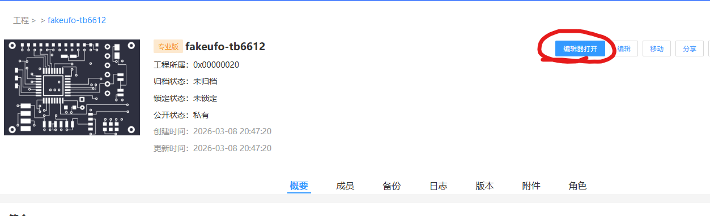

从左侧目录双击打开pcb文件
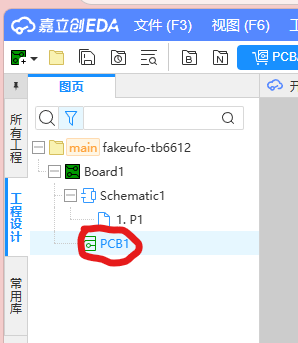

打开后什么都不用动，直接点上面菜单的导出-PCB制版文件
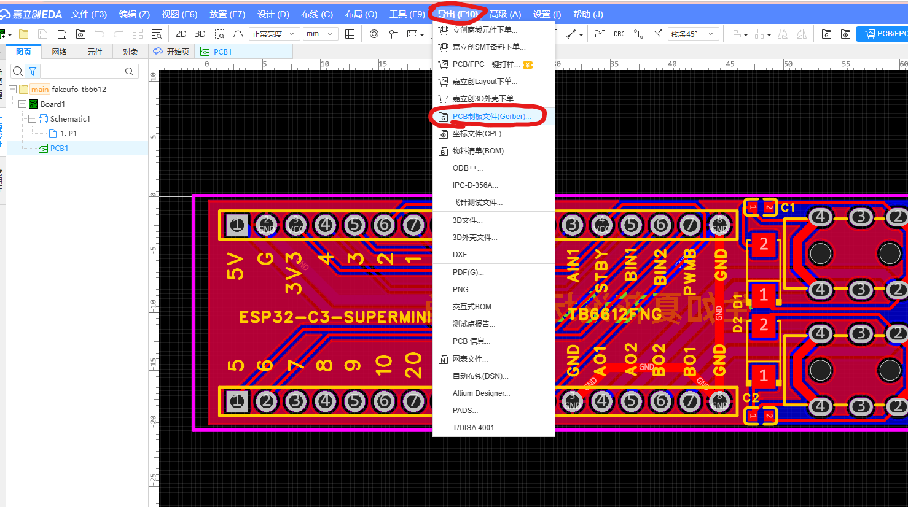
点击 pcb下单
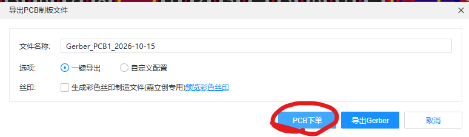
点击 否
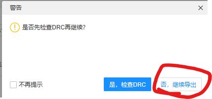
点击 确定
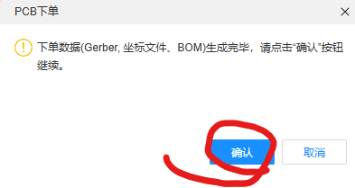

2.4.1.5 修改pcb生产参数
这里我只说几个需要手动改的，很多信息都是系统默认即可

基本信息照着这个填写
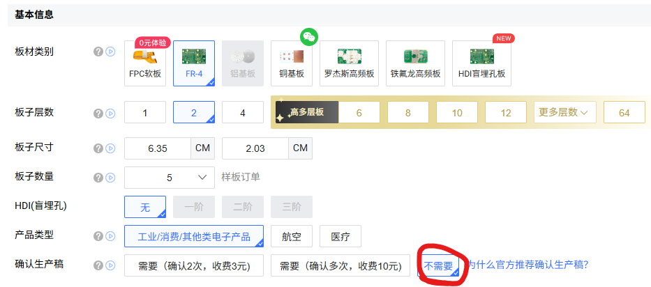
pcb工艺-出货方式：选择单片
pcb工艺-阻焊颜色：选你喜欢的颜色，在右侧可以看预览图。不过这个预览图有色差。部分冷门颜色可能会导致交期延迟或者无法使用优惠券，建议使用绿色、蓝色、白色、黑色、紫色。绿色板子交期最快。
pcb工艺-焊盘喷镀：根据前面领取的优惠券，沉金券就选择沉金、osp券同理。

pcb工艺预览图，可以照着填
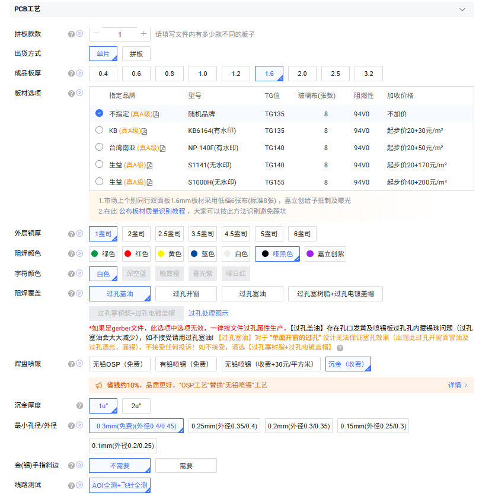

个性化服务-品质赔付服务：选择按标准合同常规处理，否则会产生费用，也没必要。
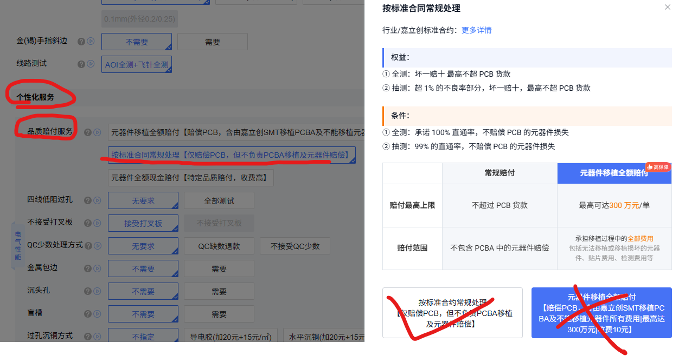
个性化服务-是否需要磨边：不需要
个性化服务-板子上加标志：随便选一个免费的即可，如果你搞不懂什么是随机位置，什么是指定位置，就选择最简单的无要求即可，不影响板子使用。
交期：一般都是正常3天，选择其他的可能产生加急费用。
SMT贴片/激光钢网：两个选项都选择不需要
开票/支付：这里需要你添加你的发票信息，一般是填写自己名字，选择增值税普通发票
确认订单方式：选择自动确认即可
发货/快递：填写你的地址，选择快递公司即可，嘉立创提供顺丰、京东、ems包邮
发货方式：不同订单不一起发货
技术联系人和下单联系人都填你自己的信息即可。

2.4.1.6 选择优惠券并下单
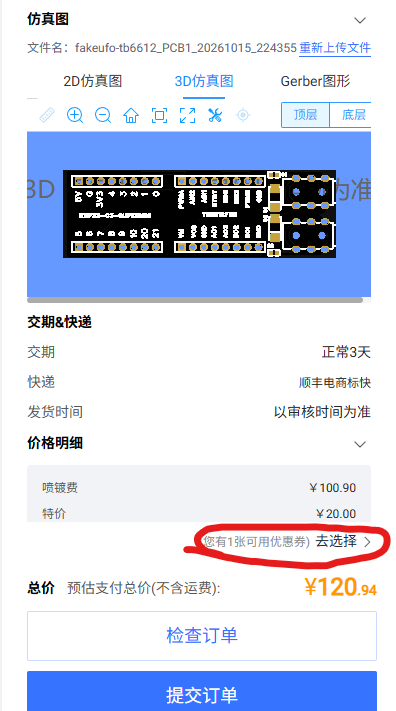
正确选择优惠券后，价格会变为免费
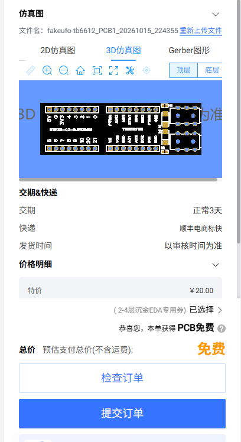
点击 检查订单，核对无误后提交订单即可

注意：下单完成后，订单进入审核期，一般很快就会被系统自动审核通过
另外，即使是免费订单，也需要有支付的环节，选择余额支付0元即可。

下单完成后，在左侧找到订单列表，可以查看工厂生产进度，以及快递信息。
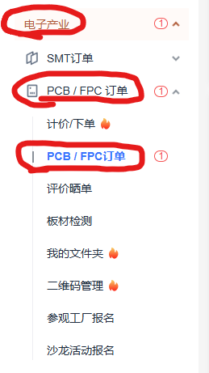
使用嘉立创微信小程序也可查看进度。

2.4.2 3d打印外壳
请注意：如果使用排母方案，则开源仓库中的外壳文件不适用。
3d打印外壳文件在这里面
https://github.com/Mistpeach/fakeUFO/tree/main/3d%E5%A4%96%E5%A3%B3
下载：壳体-5.65孔径版本.stl
以及：新-抽板.stl
这两个文件

如何白嫖3d打印外壳？
这时候就又又又又又又又又又要请出电子界的大善人嘉立创了
打开这个链接：https://www.jlc-3dp.cn/fp/Ast09a1/1
使用刚才的账号登录，参加活动，顺便帮我点点助力。
新用户会默认发一张x树脂免费打样券，把这个活动页面的优惠券能直接领的都领了。
再点击右上角-在线报价，上传你刚才下载的stl文件（如果使用免费打样券，貌似不支持一次性下单两个。可以尝试先下单壳体）
选择材料：选择x树脂-随机颜色
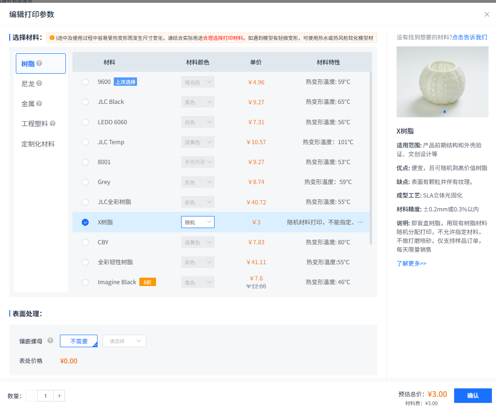
然后提交订单填信息即可，注意和pcb不一样，这里选择不同交期一起发货，可以尽量避免产生两次运费。（3d打印免费，但是不包邮）
注意：3d打印由于抽板零件比较小，所以客服可能会审核不通过，此时回复客服：我已了解并愿意承担相关风险，按照原图纸生产即可。
回复后，就能正常走到生产流程了。

3.焊接组装
3.1 检查元器件，以及其他材料
检查元器件、模块、外观是否完好，出厂焊接是否牢固，是否掉件，是否焊接歪斜。

3.2 烧录固件
由于esp开发板可能存在不良品，这里先进行烧录固件，初步排除故障可能性。

3.2.1 烧录micropython底包
电脑端下载软件，thonny。去官网下载。https://thonny.org/
用typec线连接电脑和开发板，打开电脑的设备管理器，（右键此电脑-管理-设备管理器）（或者开始菜单直接搜）
在端口下面会显示一个 usb串行设备（COM x）
括号里面的com x 就是端口号，每个人的端口号不一样，我这里显示的是com8，可能你的电脑显示com4，com12都有可能，记住这个端口号。
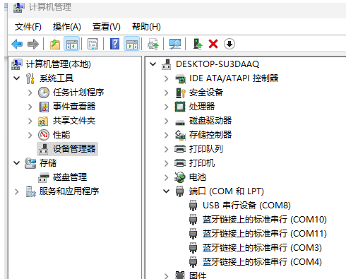
打开thonny，顶部菜单选择：运行-配置解释器

点击右下角蓝色字，安装或更新micropython

点进去等一小会加载，一般不需要科学上网。
target port就是刚才的端口号（每个人的端口号不一样，我这里显示的是com8，可能你的电脑显示com4，com12都有可能。）按照图片设置。只需要设置前三个，后面的会自动补充。
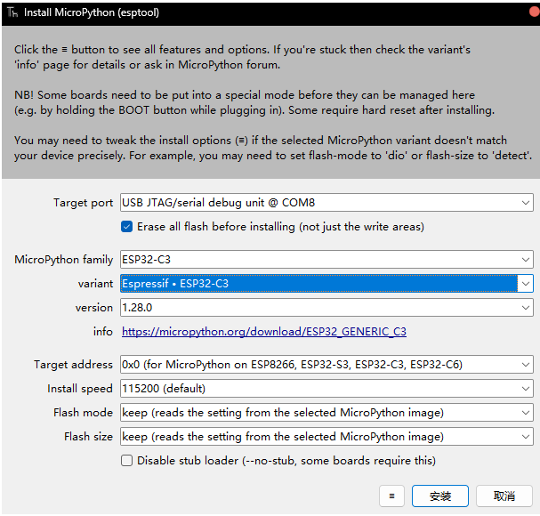
设置好之后，点击安装。等待左下角显示done，然后点击 关闭
如果点击安装没反应，请尝试按住开发板上的boot按钮，再插入usb。
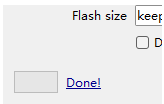
回到配置解释器的页面，按照下面图片这么设置。注意，端口那里要选择自己的端口号，或者选择自动探测端口。
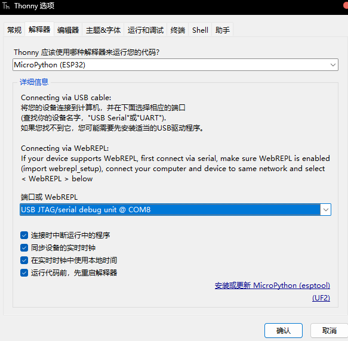
设置好之后，thonny主页面的终端会显示如下图。如果显示红字报错就是有问题，优先检查端口号。不行的话尝试拔掉开发板，关掉软件。然后先插入开发板再打开软件。
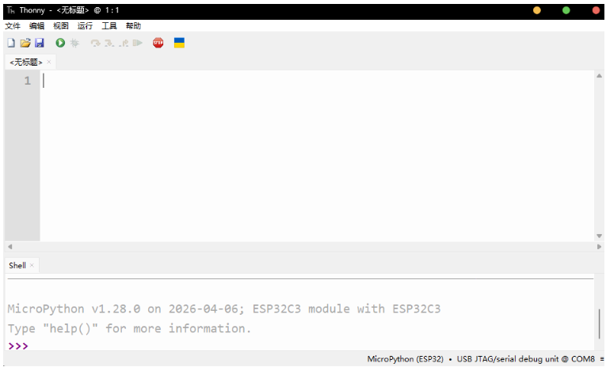

3.2.2 烧录固件
固件在下面链接里面有
https://github.com/Mistpeach/fakeUFO/tree/main/thonny%E7%83%A7%E5%BD%95%E4%BB%A3%E7%A0%81/2in1
三个文件（boot.py、main.py、motor.py）都需要下载。

下载好后，在thonny软件里，上方菜单栏选择文件-打开-此电脑-找到你保存的路径
直接烧录2in1二合一代码即可同时适配不同的app
依次打开boot.py，main.py，motor.py这三个文件。
然后把这三个文件依次保存到开发板上。（文件-另存为-micropython设备）
记得，文件名称需要自己填，boot.py，main.py，motor.py,不要写错了。提示覆盖点确认就行。
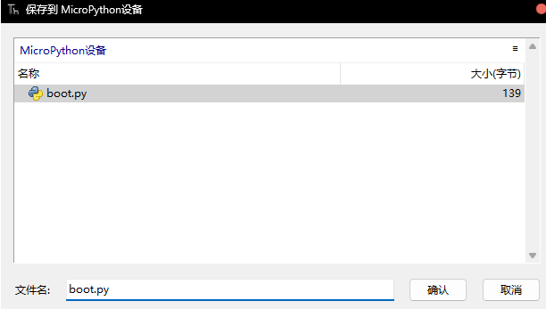
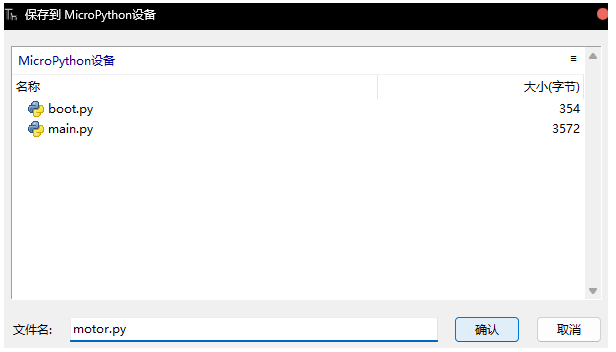
全部保存成功后，重启开发板。（或者直接拔掉typec线再插上）

3.2.3 初步测试
手机或者电脑（带蓝牙功能）使用edge 或者 chrome浏览器，打开UFO Assistant（部署在cloudflare，可能需要科学上网）
链接：
https://ufo.yumfish.cn/
进入波形控制器，左上角链接蓝牙，选择ufo-tw
如果能连接上蓝牙，证明开发板大概率是好的，如果出现问题，可以尝试重新链接，更换设备（电脑手机），断电重启等。

3.3 焊接
如果你是小白，这一步可以到家电维修部找师傅完成。活不难，一般师傅会收几块钱，基本上十块钱一下就能搞定。

3.3.1 焊接前的准备
戴好口罩，准备好烙铁、焊锡丝等工具，以及待焊接的元器件
请注意：电烙铁的电源线接在身体右侧的插座，这样可以避免高温烙铁头烫到电线引发触电。
待焊接的元器件放在左边，以免左手往右伸拿元件时候被烫伤。
可调温度的烙铁，请把温度设置到350摄氏度左右，并插电预热。

3.3.2 正式焊接
请根据图片所示，将模块和其他器件依次焊接到pcb
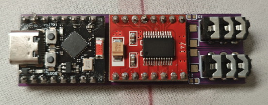
请注意板子正反面，带有字母标识的一面是正面，从此面摆放元器件，从反面上焊锡焊接。反面不应该出现任何元器件，只有针脚。
下图为正面示意
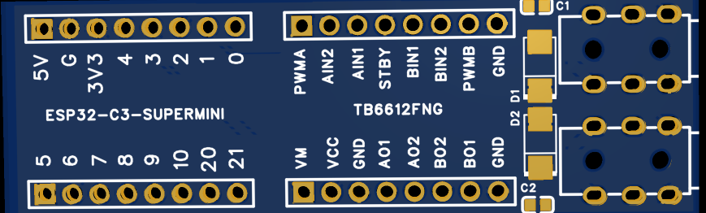
下图为反面示意
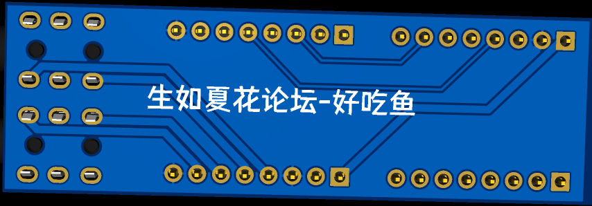
下图为反面焊接完成的示意
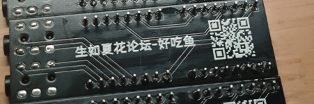
请注意模块的摆放的方向，方向反了可能会烧毁。
如果你是排母方案，那么这一步你需要把排母和3.5mm母座焊接到板子上，然后按照正确的方向和位置将模块插到排母上面。
下图为排母方案的正面焊接示意图（忽略预览图上面的贴片元器件）
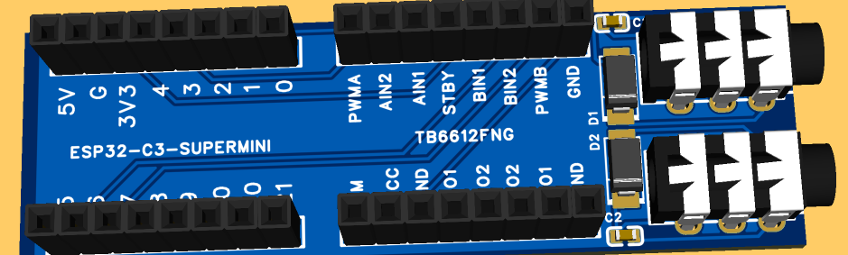

3.3.3 相关教学视频
【焊锡教学—插件-哔哩哔哩】 https://b23.tv/5uBeix6
【焊接插件的正确方法。-哔哩哔哩】 https://b23.tv/rAPHXmV
【排针排母的焊接-哔哩哔哩】 https://b23.tv/SCPoUaD

3.3.4 检查
焊接好之后，必须仔细检查是否有连锡，必须仔细检查，哪怕一点点的连锡也有可能直接坠机。

3.4 冒烟测试
如果你有万用表，建议先测量vcc、5v对地电阻，避免短路上电。
请先单独将板子通电，链接蓝牙，测试有无异常发热、糊味
确定无误后，再接入玩具，开一个简单的波形，并将两侧设置为一样的速度。
重点观察：两侧正、反转速度是否一致；调节速度，观察不同速度下两侧玩具的一致性。

3.5 组装
将引脚剪短，插入3d打印的外壳里，固定抽板，即可。
若为排母方案，请使用绝缘体将板子包起来，避免针脚露出来。

4.写在后面
当你走到这一步的时候，你已经成功完成了这个项目。开始享受瑟瑟吧。
另外，如果有相关问题请到QQ群讨论。
本文共5000＋字数，纯手打，希望对你有帮助。
如果这个项目对你有用，请打赏支持我！
链接：https://ufo.yumfish.cn/donate
另外，开发板对每个人的电脑的兼容性可能不同，如果你遇到固件烧录的问题，我提供有偿在线远程调试，需要一瓶饮料的米，调不好不收费。